# UR Robotic Arm with Robotiq 2-Finger Gripper for ROS 2

Blog post (dev journey, engineering details): [How I'm Building an Autonomous Pick-and-Place System with ROS 2 Jazzy and Gazebo Harmonic](https://medium.com/@darshmenon02/how-i-am-building-an-autonomous-pick-and-place-system-with-ros-2-jazzy-and-gazebo-harmonic-6474cbcc8dc7)

UR3 + Robotiq 2-Finger Gripper on **ROS 2 Humble** + **Gazebo Harmonic**: URDF/ros2_control, MoveIt Task Constructor pick-and-place (top-down grasps), colour/depth and VLM detection, a prototype LLM task planner (Ollama), RL (SAC), and demo recording for behavior cloning.
**New here? Start with [Full MTC Pick-and-Place Demo](#full-mtc-pick-and-place-demo)** — one command to run.

<details>
<summary><strong>Table of Contents</strong></summary>

- [Installation](#installation)
- [MoveIt Task Constructor Setup](#moveit-task-constructor-setup)
- [Launch Instructions](#launch-instructions)
- [Supported Grippers](#supported-grippers)
- [Move the Arm from CLI](#move-the-arm-from-cli)
- [Full Autonomous Pipeline](#full-autonomous-pipeline)
- [Grasp Detection (ur_grasp)](#grasp-detection-ur_grasp)
- [UR3 Reinforcement Learning (SAC)](#ur3-reinforcement-learning-sac)
- [Force Control / Compliant Grasping (ur_force_control)](#force-control--compliant-grasping-ur_force_control)
- [Behavior Tree Task Planner (ur_bt_planner)](#behavior-tree-task-planner-ur_bt_planner)
- [Conveyor Belt Simulation (ur_conveyor)](#conveyor-belt-simulation-ur_conveyor)
- [Dual-Arm Support](#dual-arm-support)
- [Visualization & Logging](#visualization--logging)
- [Gripper Benchmark (testing/)](#gripper-benchmark-testing)
- [Future Scope / Work in Progress](#future-scope--work-in-progress)

</details>

---

## Demo

.gif>)

---

## Installation

Requires [ROS 2 Humble](https://docs.ros.org/en/humble/index.html) and **Gazebo Harmonic** (`gz-sim` 8.x) — Ignition Fortress (gz-sim 6) will not work.

```bash
git clone https://github.com/darshmenon/UR3_ROS2_PICK_AND_PLACE.git
cd UR3_ROS2_PICK_AND_PLACE

export ROS_DISTRO=humble   # or jazzy
sudo apt install ros-$ROS_DISTRO-rviz2 ros-$ROS_DISTRO-joint-state-publisher \
  ros-$ROS_DISTRO-robot-state-publisher ros-$ROS_DISTRO-ros2-control \
  ros-$ROS_DISTRO-ros2-controllers ros-$ROS_DISTRO-controller-manager \
  ros-$ROS_DISTRO-joint-trajectory-controller ros-$ROS_DISTRO-position-controllers \
  ros-$ROS_DISTRO-gz-ros2-control ros-$ROS_DISTRO-ros2controlcli \
  ros-$ROS_DISTRO-moveit ros-$ROS_DISTRO-moveit-ros-perception \
  ros-$ROS_DISTRO-simple-grasping ros-$ROS_DISTRO-cv-bridge \
  ros-$ROS_DISTRO-tf2-ros ros-$ROS_DISTRO-tf2-geometry-msgs ros-$ROS_DISTRO-pcl-ros

# Jazzy only, also install: ros-jazzy-ros-gz-sim ros-jazzy-ros-gz-bridge ros-jazzy-moveit-planners-stomp
# (STOMP isn't packaged for Humble — leave it out, the planner init fails silently and is harmless)

pip3 install -r requirements.txt
pip3 install py-trees          # required for ur_bt_planner

# Ollama, for the LLM planner: install from https://ollama.com, then
ollama pull llama2:latest

# Build for Gazebo Harmonic. gz_ros2_control is built from source in src/ because the apt package
# (ros-humble-gz-ros2-control) targets Ignition Fortress and silently fails to load on Harmonic.
source /opt/ros/$ROS_DISTRO/setup.bash
GZ_VERSION=harmonic colcon build --symlink-install --cmake-args -DCMAKE_POLICY_VERSION_MINIMUM=3.5
source install/setup.bash
```

---

## MoveIt Task Constructor Setup

[MTC](https://github.com/ros-planning/moveit_task_constructor) source is already patched and vendored in `src/moveit_task_constructor/` for both Humble and Jazzy — `colcon build` above covers it, no extra steps.

MTC needs MongoDB (`warehouse_ros_mongo`) running:

```bash
curl -fsSL https://www.mongodb.org/static/pgp/server-7.0.asc | \
  sudo gpg -o /usr/share/keyrings/mongodb-server-7.0.gpg --dearmor
echo "deb [ arch=amd64,arm64 signed-by=/usr/share/keyrings/mongodb-server-7.0.gpg ] https://repo.mongodb.org/apt/ubuntu jammy/mongodb-org/7.0 multiverse" | \
  sudo tee /etc/apt/sources.list.d/mongodb-org-7.0.list
sudo apt-get update && sudo apt-get install -y mongodb-org
sudo systemctl enable --now mongod
```

Verify with `mongosh`. Humble/Jazzy API differences: [`ur_mtc_pick_place_demo/README.md`](ur_mtc_pick_place_demo/README.md).

Run MTC with one command (Gazebo + MoveIt first, MTC started after it is up), then trigger a pick and place:

```bash
ros2 launch ur_gazebo mtc_demo.launch.py gripper:=robotiq_2f_85        # default gripper is $UR_GRIPPER, else onrobot_rg2
ros2 service call /mtc_bt/run std_srvs/srv/Trigger {}                  # retries on failure; progress on /mtc_bt/status
```

**Quickstart: MTC with Gazebo and RViz** (after the install above, in a new terminal):

```bash
source /opt/ros/humble/setup.bash && source install/setup.bash
ros2 launch ur_gazebo mtc_demo.launch.py                      # Gazebo window + RViz + MoveIt + MTC
```

1. Wait about 80 s until the log prints `MTCRetryNode ready`. Gazebo and MoveIt start first, MTC follows after `mtc_delay` (50 s).
2. In a second terminal (same `source` lines) start the pick and place: `ros2 service call /mtc_bt/run std_srvs/srv/Trigger {}`
3. Watch it in RViz (Motion Planning Tasks panel shows each stage) and in the Gazebo window. `Task executed successfully` in the launch log means it worked.

| Argument | Default | Use |
|---|---|---|
| `gripper` | `$UR_GRIPPER`, else `onrobot_rg2` | `robotiq_2f_85`, `robotiq_2f_140`, `onrobot_rg2`, `onrobot_rg6` |
| `use_gazebo_gui` / `use_rviz` | `true` / `true` | set `false` to run without that window |
| `world_file` | `colored_cylinder.world` | any file from `ur_gazebo/worlds/` |
| `table_height` | `1.015` | arm mount height, must match the world; use `0.0` for the conveyor world |
| `max_attempts` | `5` | retries before giving up |

To run several setups side by side, or on a machine with other ROS 2 systems, set `export ROS_DOMAIN_ID=77` in every terminal first.

<table>
  <tr>
    <td align="center"><br><sub><b>OnRobot RG2</b>, 5 cm cylinder</sub></td>
    <td align="center">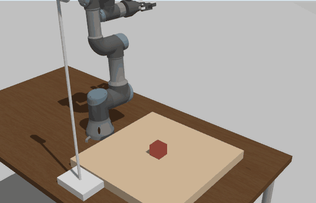<br><sub><b>Robotiq 2F-85</b>, 5 cm cube</sub></td>
  </tr>
</table>

<sub>MTC plans the whole pick and place before moving; the long planning pause is cut from these GIFs.</sub>

Reproduce: `python3 testing/benchmark_mtc.py --grippers robotiq_2f_140 --objects cylinder_5cm --trials 10 --attempts 2 --record-dir <dir>`

---

## Launch Instructions

### Full MTC Pick-and-Place Demo

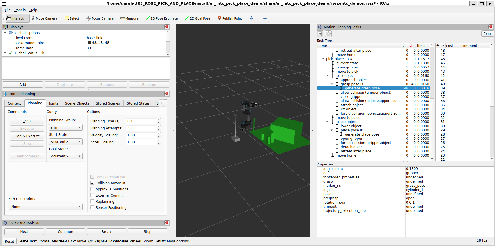

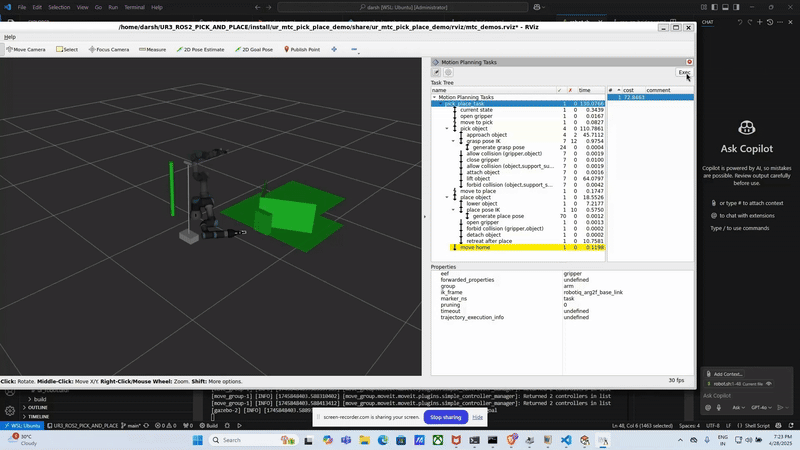

```bash
source install/setup.bash
bash ur_mtc_pick_place_demo/scripts/robot.sh              # GUI
USE_GAZEBO_GUI=false bash ur_mtc_pick_place_demo/scripts/robot.sh   # headless
```

That script just runs three launches in order (sim+MoveIt → planning scene server → pick/place task). Success looks like `Task executed successfully`. Occasional execute `-3` is RRTConnect random-seed variance, not a bug — rerun, or use the [MTC retry wrapper](#mtc-retry-wrapper) for automatic retry.

`get_planning_scene_server` turns the head depth cloud into MoveIt collision objects: crops to the workspace, RANSAC-fits the support plane and object, and serves them via `/get_planning_scene_ur`. Falls back to a known table+cylinder if perception fails or `force_fallback_scene:=true`.

### Full Simulation in Gazebo

```bash
ros2 launch ur_gazebo ur.gazebo.launch.py                       # default, Robotiq 2F-85
ros2 launch ur_gazebo ur.gazebo.launch.py gripper:=robotiq_2f_140
ros2 launch ur_gazebo ur.gazebo.launch.py gripper:=onrobot_rg2   # or onrobot_rg6
ros2 launch ur_gazebo ur.gazebo.launch.py wrist_camera:=true     # eye-in-hand instead of head cam
```

| World | Table | Objects |
|---|---|---|
| `empty.world` | no | none |
| `empty_red_cylinder.world` | no | red cylinder at `(0.36, 0, 0.06)` |
| `pick_and_place_demo.world` | yes | red cylinder + YCB props |

Launch args: `use_rviz`, `use_move_group`, `use_gazebo_gui` (all default `true`), `gripper` (default `robotiq_2f_85`), `world_file`, `table_height`, `rviz_config` (default `moveit_config/rviz/moveit.rviz` — see [Visualization & Logging](#visualization--logging) for a leaner alternative).

### Interactive MoveIt Planning in RViz

Starts move_group + RViz with `ompl` (default) and `pilz_industrial_motion_planner` pipelines.

1. **Planning Group** → `arm`
2. **Context** → Planning Library → `OMPL`, Planner → `RRTConnectkConfigDefault`
3. Drag the interactive marker to a goal, click **Plan & Execute**

Cartesian (straight-line) moves: RViz **Cartesian Path** tab, or Pilz `LIN`/`PTP`/`CIRC` planners. Configs: `moveit_config/config/ompl_planning.yaml`, `pilz_cartesian_limits.yaml`.

To attach RViz/MoveIt to a sim already running headless, use `moveit_config move_group.launch.py` with `use_move_group`/`use_rviz`/`use_sim_time` flags instead.

Wait ~10-15s after launch, then confirm:

```bash
ros2 control list_controllers   # arm_controller, gripper_controller, joint_state_broadcaster — all active
```

---

## Supported Grippers

| Gripper | Arg | Actuated joint | Range (open→closed) |
|---|---|---|---|
| Robotiq 2F-85 | `robotiq_2f_85` | `finger_joint` | 0.0 → 0.8 |
| Robotiq 2F-140 | `robotiq_2f_140` | `finger_joint` | 0.0 → 0.8 |
| OnRobot RG2 | `onrobot_rg2` | `gripper_joint` | 0.0 → 1.3 |
| OnRobot RG6 | `onrobot_rg6` | `gripper_joint` | 0.0 → 1.3 |

**Default gripper: `onrobot_rg2`** (best benchmark result, see below). Every single-arm launch file reads `UR_GRIPPER`, so `export UR_GRIPPER=robotiq_2f_85` switches the whole stack (Gazebo, MoveIt, MTC, `MotionExecutor`) at once; the `gripper:=` launch argument still overrides it. The dual-arm launches stay on the Robotiq grippers.

All use `position_controllers/GripperActionController`. Mimic joints are state-only — Gazebo Harmonic enforces `<mimic>` constraints at the physics level.

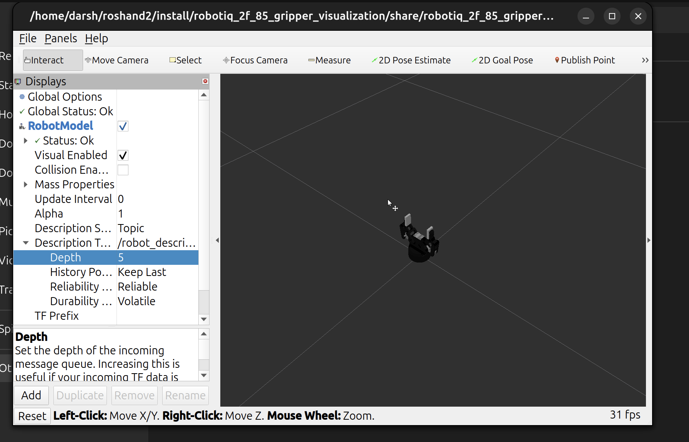

```bash
ros2 action send_goal /gripper_controller/gripper_cmd control_msgs/action/GripperCommand \
  "{command: {position: 0.5, max_effort: 50.0}}"
```

Useful debug commands: `ros2 topic echo /joint_states`, `ros2 topic hz /camera_head/depth/color/points`, `ros2 run tf2_ros tf2_echo base_link tool0`.

---

## Move the Arm from CLI

```bash
ros2 action send_goal /arm_controller/follow_joint_trajectory control_msgs/action/FollowJointTrajectory \
'{"trajectory": {"joint_names": ["shoulder_pan_joint","shoulder_lift_joint","elbow_joint","wrist_1_joint","wrist_2_joint","wrist_3_joint"],
  "points": [{"positions": [0.0, -1.57, 1.57, 0.0, 1.57, 0.0], "time_from_start": {"sec": 2, "nanosec": 0}}]}}'
```

Automation script: `python3 ur_system_tests/scripts/arm_gripper_loop_controller.py`. GUI: `python3 ur_system_tests/scripts/gui.py`.

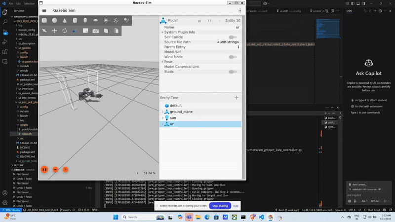

---

## Full Autonomous Pipeline

`full_demo.launch.py` brings up Gazebo, MoveIt, perception, grasp detection, and a selectable brain (mutually exclusive):

```bash
ros2 launch ur_gazebo full_demo.launch.py brain:=llm      # Ollama, via /llm_planner/command
ros2 launch ur_gazebo full_demo.launch.py brain:=rl model_path:=ur_rl_training/models/checkpoints/<run>/best_model.zip
ros2 launch ur_gazebo full_demo.launch.py brain:=openvla task:="pick the red block and place it in the bin"
ros2 launch ur_gazebo full_demo.launch.py brain:=none     # perception + grasp only
```

Startup sequence: Gazebo+MoveIt → perception (60s) → grasp (62s) → brain (65s).

None of the brains here use MTC: the LLM brain drives the arm through `MotionExecutor`, and the RL and OpenVLA policies publish joint trajectories directly. The MTC pipeline with its own point-cloud scene server and behavior-tree retry is a separate launch (`ros2 launch ur_gazebo mtc_demo.launch.py`); the two are not chained.

```
Camera/Depth  → ur_perception → /detected_objects        → LLM planner / RL policy
PointCloud2   → ur_grasp      → /ur_grasp/grasp_pose      → RL policy (overrides perception)
Camera        → OpenVLA       → /arm_controller/joint_trajectory
```

---

## Grasp Detection (ur_grasp)

Estimates grasp poses from the D435 point cloud — `simple_grasping` (PCL RANSAC, primary) or a built-in HSV-centroid fallback.

```bash
ros2 launch ur_grasp grasp_detection.launch.py colour:=red
python3 testing/test_grasp.py --colour red --execute
```

For eye-in-hand: launch sim with `wrist_camera:=true`, then point `grasp_detection.launch.py` at `camera_topic:=/camera_wrist/depth/color/points`. Publishes `/ur_grasp/grasp_pose` and `/ur_grasp/grasp_marker`.

---

## UR3 Reinforcement Learning (SAC)

Trains SAC in MuJoCo, deploys to Gazebo — reach → grasp → lift → place curriculum (auto-advances at eval reward ≥ 400), with domain randomization on mass/friction/size/noise.

```bash
cd ur_rl_training
python3 scripts/train.py --timesteps 3000000
python3 scripts/train.py --resume models/checkpoints/<run>/best_model   # resume from checkpoint
```

Deploy to Gazebo:

```bash
ros2 launch ur_gazebo ur.gazebo.launch.py world_file:=rl_policy_demo.world
ros2 launch ur_rl_training rl_policy.launch.py model_path:=ur_rl_training/models/checkpoints/<run>/best_model.zip
```

Key params: `action_scale` (0.1), `step_dt` (0.01), `control_rate_hz` (100), `phase` (0-3); object position auto-overridden by perception/grasp topics when running.

Headless eval: `python3 ur_rl_training/scripts/eval_headless.py --model <path> --episodes 20`.

Compare training runs (reads all `ur_rl_training/logs/*/evaluations.npz`, no launch needed):

```bash
python3 testing/plot_rl_run_comparison.py
# -> testing/rl_learning_curves.png, testing/rl_best_reward_bar.png
```

---

## Force Control / Compliant Grasping (`ur_force_control`)

**Gripper contact** — monitors `finger_joint` effort to stop before crushing:

```bash
ros2 launch ur_force_control ft_monitor.launch.py
```
`/ft/finger_effort` (effort), `/ft/contact_detected` (bool), service `/ft/compliant_close`. Also via `MotionExecutor.compliant_close_gripper()` / `.compliant_pick()`.

**Arm-level wrench estimation** (no F/T sensor — inferred from joint effort via `F ≈ pinv_damped(Jᵀ)·τ_ext`, gravity via Pinocchio):

```bash
ros2 launch ur_force_control wrench_estimator.launch.py
ros2 topic echo /ft/estimated_wrench
ros2 service call /ft/zero_wrench std_srvs/srv/Trigger {}
```
Params: `force_threshold_n` (15.0), `damping_lambda` (0.05). Note: `/joint_states` effort readback doesn't reliably track commanded torque, so absolute wrench values aren't trustworthy yet — relative/contact detection is fine.

**Joint impedance control** (torque mode, `τ = K(q_des−q) − D·q̇ + g(q)`):

```bash
ros2 launch ur_force_control joint_impedance.launch.py
ros2 control switch_controllers --deactivate arm_controller --activate forward_command_controller_effort
ros2 topic pub --once /joint_impedance_controller/target_positions std_msgs/msg/Float64MultiArray "{data: [0.0, -1.57, 1.57, 0.0, 1.57, 0.0]}"
ros2 control switch_controllers --deactivate forward_command_controller_effort --activate arm_controller   # hand back
```
Use `arm_controller` for MoveIt; switch to `forward_command_controller_effort` only for compliant hold/contact. Service: `/joint_impedance_controller/hold_current_pose`.

**Peg in hole (Cartesian impedance + spiral search)** — the UR3 holds a peg above a hole in headless Gazebo and pushes it in with compliant control. When the peg lands on the top face (axial force up, depth ~0), the task node runs a spiral search around the nominal hole until the peg drops in (`hole_found`: axial force low and depth > 3 mm). Control law and spiral are in `ur_force_control/admittance.py`.

<table>
  <tr>
    <td align="center">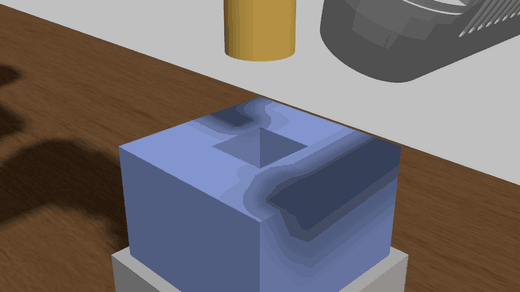<br><sub>0.4 mm off: goes straight in</sub></td>
    <td align="center">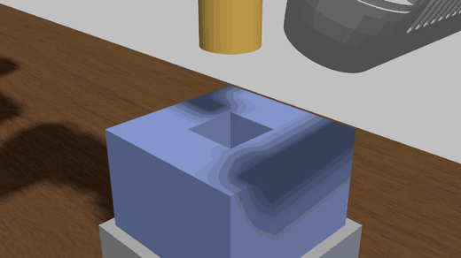<br><sub>4 mm off, no search: jams</sub></td>
    <td align="center"><br><sub>4 mm off, spiral search: finds the hole</sub></td>
  </tr>
</table>

| Case | Start offset | Result | Peak axial force |
|---|---|---|---|
| Aligned | 0.4 mm | inserted 27 mm | 0.7 N |
| Jammed (no search) | 4 mm | stuck at 1 mm depth | 21.6 N |
| Spiral search | 4 mm | inserted 27 mm in ~14 s | 3.6 N while searching |

Force plots: `assets/gifs/peg_in_hole_ur3*_forces.png`, raw data in the matching `.csv` (position, depth, lateral/axial force, mode, rotation error).

```bash
python3 ur_force_control/scripts/record_peg_in_hole.py --out assets/gifs/peg_in_hole_ur3_spiral.gif --offset-x 0.004 --search
```
Starts the sim headless, films the close-up camera, and writes the GIF, CSV and force plot. The wrench is estimated from joint effort, so forces are relative, not calibrated.

---

## Behavior Tree Task Planner (`ur_bt_planner`)

Hierarchical [py_trees](https://py-trees.readthedocs.io/) pick-and-place with IK-failure retry via a Selector fallback:

```bash
ros2 launch ur_bt_planner bt_planner.launch.py pick_x:=0.35 pick_y:=0.0 pick_z:=0.05 place_x:=0.15 place_y:=0.30 place_z:=0.08
ros2 service call /bt/run_pick_place std_srvs/srv/Trigger {}
```

### MTC Retry Wrapper

Wraps the [MTC demo](#full-mtc-pick-and-place-demo) with automatic retry (`py_trees.decorators.Retry`) since occasional `-3` execute failures resolve on a fresh attempt:

```bash
ros2 launch ur_gazebo ur.gazebo.launch.py world_file:=pick_and_place_demo.world gripper:=robotiq_2f_85 \
  use_rviz:=false use_move_group:=true use_gazebo_gui:=true
ros2 launch ur_bt_planner mtc_retry.launch.py
ros2 service call /mtc_bt/run std_srvs/srv/Trigger {}
ros2 topic echo /mtc_bt/status
```
`max_attempts` (default 5) is a launch arg.

---

## Conveyor Belt Simulation (`ur_conveyor`)

Spawns random-color boxes at the belt entry, moves them to the pick zone, publishes `/conveyor/object_ready`.

```bash
ros2 launch ur_conveyor conveyor.launch.py spawn_interval_s:=6.0 belt_speed:=0.03
ros2 service call /conveyor/start std_srvs/srv/Trigger {}
```

Topics/services: `/conveyor/object_ready`, `/conveyor/picked`, `/conveyor/start`, `/conveyor/stop`.

The arm picks each box off the belt and drops it on the bin of its colour (`python3 testing/conveyor_pick_demo.py`).

<p align="center">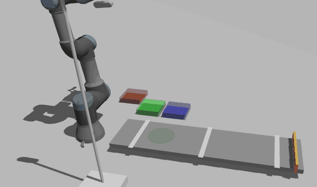</p>

<table align="center">
  <tr>
    <td align="center">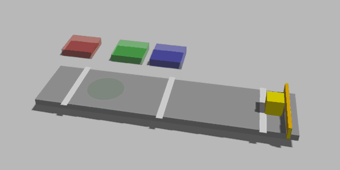<br><sub>belt feed</sub></td>
    <td align="center"><br><sub>YOLO detection on the belt</sub></td>
  </tr>
</table>

---

## Dual-Arm Support

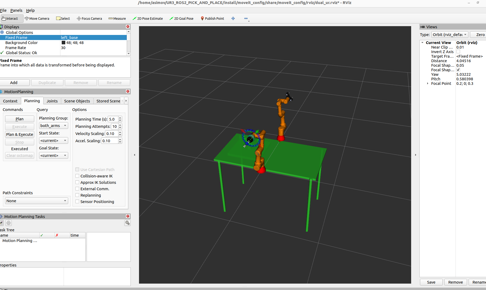

Two independent UR3+gripper arms (`left_`/`right_` prefixed) on one shared world frame, one Gazebo model, one `controller_manager`.

```bash
ros2 launch ur_gazebo dual_ur.gazebo.launch.py            # GUI
ros2 launch ur_gazebo dual_ur.gazebo.launch.py use_gazebo_gui:=false gripper:=robotiq_2f_85
```

Args: `gripper` (all 4 grippers), `table_height`, `left_y`/`right_y` (base offsets, default ±0.45 m), `world_file`, `use_move_group`, `use_rviz`, `use_dual_cameras` (per-arm D435, off by default).

MoveIt groups: `left_arm`, `right_arm`, `left_gripper`, `right_gripper` and `both_arms`; `move_group` and RViz start by default.

**Independent per-arm pipelines** (namespaced `left`/`right`, fallback planning scene — no live perception dependency yet):

```bash
ros2 launch ur_gazebo dual_mtc_pick_place.launch.py     # two mtc_node instances
ros2 launch ur_bt_planner dual_mtc_retry.launch.py      # + BT auto-retry per arm
ros2 launch ur_sorting_demo dual_sorting_demo.launch.py # workspace-split sorting
```

**Whole-body coordination** (`ur_dual_coordination`): both hands hold one object and all 12 joints are solved together. Priorities: keep the hands' relative pose and the arms apart, move the object to its target, stay near a comfortable posture. Joints at their limits are frozen.

```bash
ros2 launch ur_dual_coordination dual_coordination.launch.py               # with the dual-arm sim running
ros2 service call /dual/grasp std_srvs/srv/Trigger {}                      # freeze the hands' relative pose
ros2 topic pub --once /dual/object_target geometry_msgs/msg/PoseStamped \
  "{header: {frame_id: world}, pose: {position: {x: 0.2, y: 0.0, z: 0.31}, orientation: {w: 1.0}}}"
ros2 service call /dual/release std_srvs/srv/Trigger {}
```

<p align="center">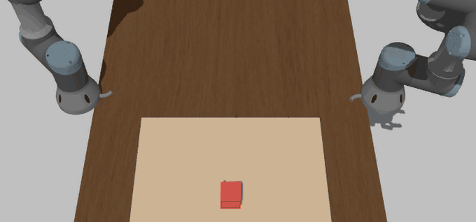</p>

Note: the object/place/bin/handover poses in the per-arm pipelines are placeholders from the single-arm demo and are not yet confirmed reachable.

---

## Visualization & Logging

**RViz.** The default config (`moveit_config/rviz/moveit.rviz`, also used by `dual_ur.gazebo.launch.py` via `dual_ur.rviz`) now starts framed on the workspace instead of zoomed out to the whole world, has the MTC **Motion Planning Tasks** panel pre-expanded with computation times shown, and carries a **Detection Image** display (`/detection_image`, off by default — enable it in the Displays panel when `ur_perception`'s object detector is running).

For a monitoring-only view (no planning controls, no MTC debug panel), pass an alternate config:

```bash
ros2 launch ur_gazebo ur.gazebo.launch.py \
  rviz_config:=$(ros2 pkg prefix moveit_config)/share/moveit_config/rviz/operator_view.rviz
```

**Native log/plot viewers.** `rqt_console` and PlotJuggler, wired up as a convenience launch:

```bash
ros2 launch ur_web_dashboard view_logs.launch.py                    # both
ros2 launch ur_web_dashboard view_logs.launch.py plotjuggler:=false # rqt_console only
```

---

## Gripper Benchmark (`testing/`)

### Pick and place with each gripper

<table>
  <tr>
    <td align="center">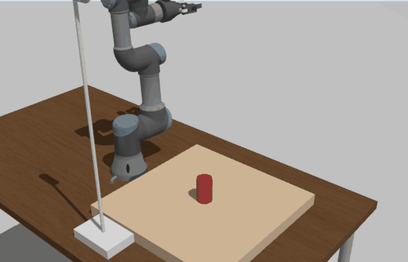<br><sub><b>Robotiq 2F-85</b>, 5 cm cylinder</sub></td>
    <td align="center">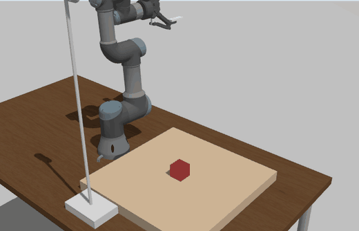<br><sub><b>Robotiq 2F-140</b>, 5 cm cube</sub></td>
  </tr>
  <tr>
    <td align="center"><br><sub><b>OnRobot RG2</b> (default), 5 cm cube</sub></td>
    <td align="center">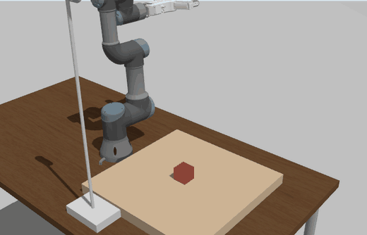<br><sub><b>OnRobot RG6</b>, 5 cm cube</sub></td>
  </tr>
</table>

### Different shapes (OnRobot RG2)

<table>
  <tr>
    <td align="center">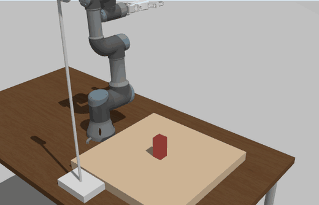<br><sub>tall box</sub></td>
    <td align="center"><br><sub>5 cm cylinder</sub></td>
  </tr>
</table>

<details>
<summary>The same runs as still contact sheets (arm at home, approach, grasp, lift, carry, placed)</summary>

<table>
  <tr>
    <td align="center">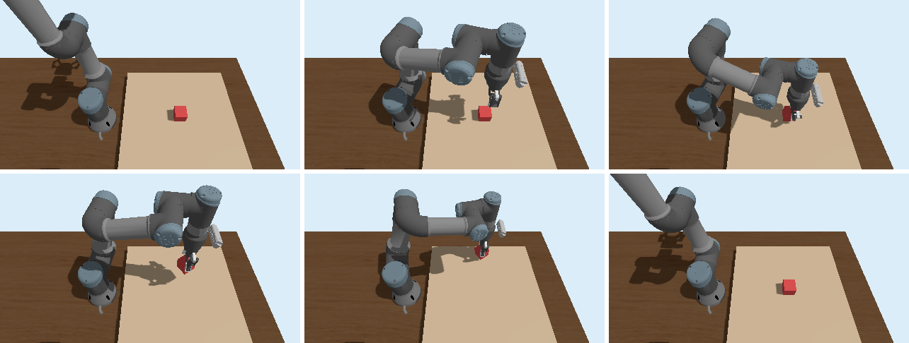<br><sub>Robotiq 2F-85, 5 cm cube</sub></td>
    <td align="center">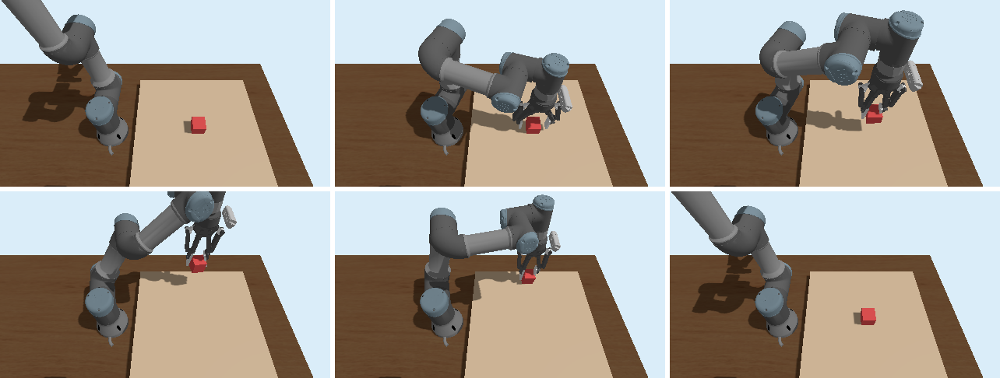<br><sub>Robotiq 2F-140, 5 cm cube</sub></td>
  </tr>
  <tr>
    <td align="center">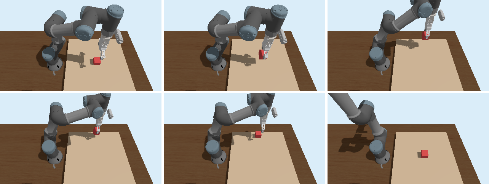<br><sub>OnRobot RG2, 5 cm cube</sub></td>
    <td align="center">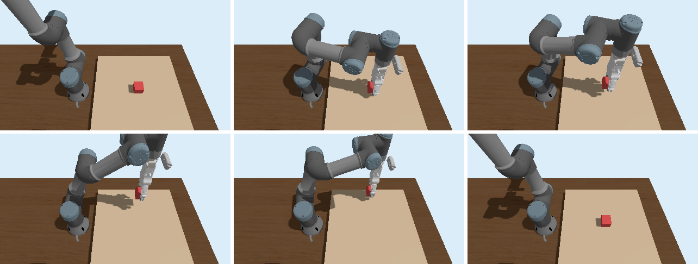<br><sub>OnRobot RG6, 5 cm cube</sub></td>
  </tr>
</table>

</details>

### Pad friction in Gazebo

Friction set on a link that a fixed joint merges into its parent is dropped from the generated SDF, so the 2F-85 pads had no friction until it was also set on the inner finger. Check with `gz sdf -p`. Adding the RG2's torsional friction (0.456, patch radius 0.05) to the 2F-85 raised a 5 cm cylinder from 4/10 to 7/10 within 20 mm. On the 2F-140 it made no difference (12/20, same as without).

### Running it

```bash
python3 testing/benchmark_grippers.py --trials 5 --domain 91 --output results.csv   # all grippers x objects
python3 testing/benchmark_grippers.py --grippers onrobot_rg2 --objects cube_5cm --record-dir frames/   # + PASS/FAIL image strips
python3 testing/benchmark_grippers.py --summarise-csv results.csv                   # print the table again
```

---

## VLM Target Selection and Grasp Comparison

A local vision-language model picks *which* object to grab from a text query; the colour + depth detector
supplies the precise 3D pose. No cloud, no API key.

```bash
ollama pull qwen2.5vl:3b                      # 3.2 GB, one time
ros2 launch ur_perception perception.launch.py
ros2 run ur_perception vlm_grounding_node.py   # publishes /vlm/target_pose and /vlm/target_object_id
ros2 topic pub --once /vlm/query std_msgs/String "{data: 'the red cylinder'}"
```

The VLM returns a box, and the detected object inside it becomes the pose (the 3B model's boxes are loose, so the
pose never comes from the box). No match publishes nothing. `get_planning_scene_server` picks the object nearest
`/vlm/target_pose`.

<p align="center">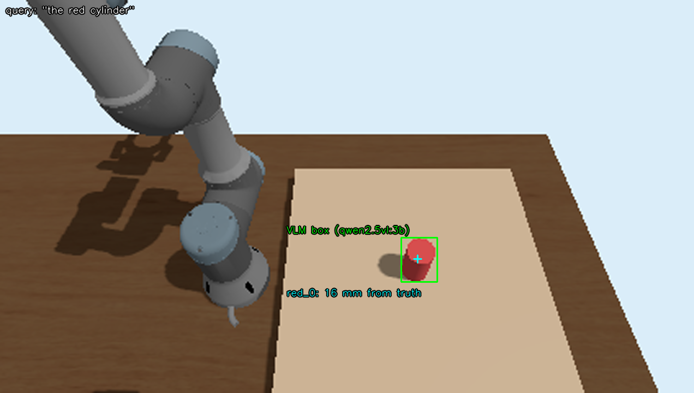<br><sub>Query "the red cylinder": VLM box (green) and the detected object it selects (cross)</sub></p>

```bash
ros2 topic echo /vlm/target_object_id          # which detected object the VLM chose
ros2 topic echo /vlm/target_pose               # its pose in base_link
ros2 topic pub --once /vlm/query std_msgs/String "{data: 'the red cylinder'}"
```

The node log prints each answer, for example
`"the red cylinder": box=(245,145,267,172) -> red_0 at base_link (0.342, -0.014, 0.118)`.
The first query takes 15-30 s while Ollama loads the model; later ones take a few seconds.

Picked and placed from a text query, with several objects on the table (Robotiq 2F-85):

<table>
  <tr>
    <td align="center">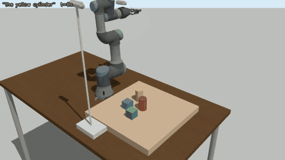<br><sub><b>"the yellow cylinder"</b></sub></td>
    <td align="center"><br><sub><b>"the red cylinder"</b></sub></td>
  </tr>
  <tr>
    <td align="center">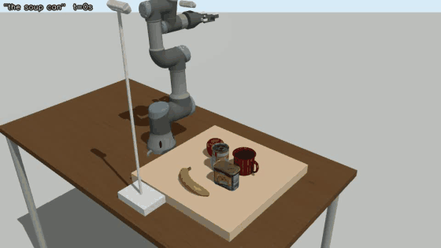<br><sub><b>"the soup can"</b> (YCB objects)</sub></td>
  </tr>
</table>

The VLM chose the right object in every run. The pick-and-place itself succeeded in about half of the runs: MTC
sometimes stops when the arm clips a neighbouring object (see `testing/vlm_pick_check.py`).

Check it against Gazebo ground truth (cylinder at 0.35, 0.00):

```bash
python3 testing/vlm_check.py --object cylinder_5cm --domain 78
```

| Method | xy error vs truth | Notes |
|---|---|---|
| Colour + depth detector | 16 mm | red objects only |
| VLM (qwen2.5vl:3b) + detector | 16 mm | picks the right object from "the red cylinder"; refuses absent objects |
| Contact-GraspNet (PyTorch port) | 16-23 mm (contact point) | 58 grasps on the cylinder, all within its 25 mm radius; side grasps, ~6 s per pass |

Contact-GraspNet runs on a captured view with `testing/graspnet_check.py capture|run` (no CUDA build; model
weights come with the repo). It needs the GPU free, so unload the VLM first.

Point-cloud detector fix: clusters taller than `simple_max_object_height` (0.20 m) are dropped. They were the arm's
own links, which made MTC stop mid-execution with "path became invalid". On the 2F-140 + 5 cm cylinder benchmark
this took the pass rate from 3 of 10 to 5 of 9.

## Future Scope / Work in Progress

Checked against the repo and public sources (Nov 2026). Already in the tree, so not listed again: VLM text grounding, Contact-GraspNet, `ur_dual_coordination` (12-joint Pinocchio carry), `full_sorting_demo.launch.py` (conveyor + perception + sorting), and HDF5 → LeRobot export.

- **Real UR3.** Swap the Gazebo `gz_ros2_control` hardware interface for the official driver, [UniversalRobots/Universal_Robots_ROS2_Driver](https://github.com/UniversalRobots/Universal_Robots_ROS2_Driver) (Humble, Jazzy, Kilted, Lyrical, Rolling). On Jazzy: `sudo apt install ros-jazzy-ur`, extract the factory calibration, then `ros2 launch ur_robot_driver ur_control.launch.py ur_type:=ur3 robot_ip:=<ip>`. Skipping calibration puts the TCP off by centimetres. Use `ur_controllers` (`scaled_joint_trajectory_controller`) so pendant speed scaling still works. [Install](https://docs.universal-robots.com/Universal_Robots_ROS2_Documentation/jazzy/doc/ur_robot_driver/ur_robot_driver/doc/installation/installation.html), [startup](https://docs.universal-robots.com/Universal_Robots_ROS2_Documentation/jazzy/doc/ur_robot_driver/ur_robot_driver/doc/usage/startup.html).
- **VLA fine-tune, not stock OpenVLA.** `ur_openvla` still runs autoregressive `openvla-7b` joint deltas. The current recipe is OpenVLA-OFT (Kim, Finn, Liang, [arXiv:2502.19645](https://arxiv.org/abs/2502.19645), [moojink/openvla-oft](https://github.com/moojink/openvla-oft)): parallel decoding, action chunks, continuous actions, L1 loss. On LIBERO that moves average success from 76.5% to 97.1% and action throughput about 26×. Demos must be RLDS, which `ur_data_collector` does not write yet. A UR5e + Robotiq 2F-85 pipeline that already does this is [ChangChrisLiu/DataCollection](https://github.com/ChangChrisLiu/DataCollection) (EEF deltas over `moveL`). UR push-T fine-tunes have stalled with a high, oscillating loss when the global batch is small or the demos are multimodal ([openvla-oft#73](https://github.com/moojink/openvla-oft/issues/73)). The other path is π₀ / π₀.₅ (Black et al., [arXiv:2410.24164](https://arxiv.org/abs/2410.24164); [Physical-Intelligence/openpi](https://github.com/Physical-Intelligence/openpi), π₀.₅ released Sept 2025), which matches the flow-matching head already in `ur_flow_policy` and can train from the existing LeRobot export.
- **6-DoF object pose.** Colour + depth still gives position, not grasp orientation. FoundationPose (Wen et al., CVPR 2024) has ROS 2 wrappers that publish a tracked 6-D pose from an RGB-D stream plus a mesh: [ammar-n-abbas/FoundationPoseROS2](https://github.com/ammar-n-abbas/FoundationPoseROS2) (Humble, SAM 2, multi-object, 8 GB GPU) and [IRVLUTD/FoundationPoseROS](https://github.com/IRVLUTD/FoundationPoseROS). YCB meshes in `ur_gazebo` are the models; the pose still has to land in the MoveIt planning scene.
- **6-DoF grasps beyond Contact-GraspNet.** The in-repo port returns side grasps (16–23 mm on the 5 cm cylinder) but is not what MTC executes. GraspGen (Murali et al., [arXiv:2507.13097](https://arxiv.org/abs/2507.13097), ICRA 2026, [NVlabs/GraspGen](https://github.com/NVlabs/GraspGen)) ships a Robotiq 2F-140 checkpoint, reports 81.3% real grasp success on a UR10 with a Robotiq gripper, and runs at about 20 Hz before TensorRT. Ranked grasps should replace the cylinder heuristic inside the MTC grasp stage.
- **Coordinated dual arm.** MTC still plans one Cartesian end-effector per stage; a combined group only takes joint goals, and `Merger` only stitches independent group plans ([moveit_task_constructor#390](https://github.com/moveit/moveit_task_constructor/issues/390)). Keep `ur_dual_coordination` for the shared-object carry. Left to do: replace the placeholder object, place, and handover poses (the file headers say they are unconfirmed), use `Merger` for the two approaches, then hand the grasped object to `/dual/object_target`. [emusman-lab/dual_robot_arm](https://github.com/emusman-lab/dual_robot_arm) is a ROS 2 MTC dual-arm pick, but the arms run one after the other.
- **Sorting supervisor.** Conveyor, perception, and colour bins already start together from `ur_sorting_demo` `full_sorting_demo.launch.py`. What is missing is `ur_bt_planner` as the supervisor, and real bin poses: `bins_left.yaml` / `bins_right.yaml` are still the single-arm defaults shifted sideways.
- **Reconstruction into the pick.** `reconstruct.launch.py` fuses a wrist cloud and can save a mesh, and nothing in the pick pipeline reads it. Publishing that cloud as collision geometry is the direct fix for the VLM picks that die when the arm clips a neighbour (about half the runs in `testing/vlm_pick_check.py`). The same mesh is the FoundationPose model above.
- **Language pick through the planner.** `vlm_grounding_node` already resolves “the red cylinder” to `/vlm/target_pose`. `llm_planner_node` still plans only from `/detected_objects`, so a text command fails when that detector returns nothing. Subscribe to the VLM pose and object id and pass that object into `MotionExecutor`.
- **Real gripper, separate from the arm.** The official driver is [robotiq/robotiq-ros](https://github.com/robotiq/robotiq-ros) (January 2026; Humble, Jazzy, Lyrical; 2F-85 and 2F-140). On Jazzy the gripper action is `ParallelGripperCommand`, not `GripperCommand`, so `MotionExecutor` will not close a live gripper until that goal type is handled.
- **Hand-eye before a real camera.** Simulation TF is exact, so the current detection error will not survive a physical camera. [easy_handeye2](https://github.com/marcoesposito1988/easy_handeye2) covers eye-on-base for the head camera and eye-in-hand for the wrist camera. Prove the solve in sim by shifting the camera a known amount and checking that the calibration recovers it.
- **Clutter motion, not more padding.** Six millimetres of robot padding only partly stops “path became invalid” when the upper arm sweeps a neighbour. [isaac_ros_cumotion](https://github.com/nvidia-isaac-ros/isaac_ros_cumotion) is a MoveIt 2 planning pipeline (cuRobo). It needs an XRDF for this UR3. With nvblox it plans against a depth signed-distance field, which is the reconstructed cloud the pick does not read today. Execution stays Gazebo or URSim; that tutorial has no fake UR hardware.
- **Close the last centimetres in the loop.** MTC plans the whole task before the arm moves. Pilz `LIN` is already configured and can take the approach, lift, and retreat. `ur_visual_servo` already servos to `/ur_grasp/grasp_pose` and is never called from the pick. Run both on the same benchmark seeds and compare cycle time and the 20 mm place rate.
- **Leave force control alone until it holds.** The joint impedance controller does not hold a pose in this Gazebo after the switch to effort mode (the arm drifts, and the drift is not repeatable). A peg-in-hole comparison is not informative until a hold is stable.
- **Conveyor pick is stop-then-grasp.** `conveyor_node` moves boxes by teleporting them, and the demo marks `/conveyor/picked` before the grasp so the box freezes. Picking while the belt is still moving is a separate task.

Contributions welcome, especially around sim stability, transfer learning, and perception-to-action integration.
