# UR Robotic Arm with Robotiq 2-Finger Gripper for ROS 2

Blog post (dev journey, engineering details): [How I'm Building an Autonomous Pick-and-Place System with ROS 2 Jazzy and Gazebo Harmonic](https://medium.com/@darshmenon02/how-i-am-building-an-autonomous-pick-and-place-system-with-ros-2-jazzy-and-gazebo-harmonic-6474cbcc8dc7)

UR3 + Robotiq 2-Finger Gripper on **ROS 2 Humble** + **Gazebo Harmonic**: URDF/ros2_control, MoveIt Task Constructor pick-and-place, vision-based detection, LLM task planning (Ollama), RL (SAC), and demo recording for behavior cloning.

**New here? Start with [Full MTC Pick-and-Place Demo](#full-mtc-pick-and-place-demo)** — one command to run.

<details>
<summary><strong>Table of Contents</strong></summary>

- [Installation](#installation)
- [MoveIt Task Constructor Setup](#moveit-task-constructor-setup)
- [Launch Instructions](#launch-instructions)
- [Supported Grippers](#supported-grippers)
- [Move the Arm from CLI](#move-the-arm-from-cli)
- [Full Autonomous Pipeline](#full-autonomous-pipeline)
- [Grasp Detection (ur_grasp)](#grasp-detection-ur_grasp)
- [UR3 Reinforcement Learning (SAC)](#ur3-reinforcement-learning-sac)
- [Force Control / Compliant Grasping (ur_force_control)](#force-control--compliant-grasping-ur_force_control)
- [Behavior Tree Task Planner (ur_bt_planner)](#behavior-tree-task-planner-ur_bt_planner)
- [Conveyor Belt Simulation (ur_conveyor)](#conveyor-belt-simulation-ur_conveyor)
- [Dual-Arm Support](#dual-arm-support)
- [Visualization & Logging](#visualization--logging)
- [Gripper Benchmark (testing/)](#gripper-benchmark-testing)
- [Future Scope / Work in Progress](#future-scope--work-in-progress)

</details>

---

## Demo

.gif>)

---

## Installation

Requires [ROS 2 Humble](https://docs.ros.org/en/humble/index.html) and **Gazebo Harmonic** (`gz-sim` 8.x) — Ignition Fortress (gz-sim 6) will not work.

```bash
git clone https://github.com/darshmenon/UR3_ROS2_PICK_AND_PLACE.git
cd UR3_ROS2_PICK_AND_PLACE

export ROS_DISTRO=humble   # or jazzy
sudo apt install ros-$ROS_DISTRO-rviz2 ros-$ROS_DISTRO-joint-state-publisher \
  ros-$ROS_DISTRO-robot-state-publisher ros-$ROS_DISTRO-ros2-control \
  ros-$ROS_DISTRO-ros2-controllers ros-$ROS_DISTRO-controller-manager \
  ros-$ROS_DISTRO-joint-trajectory-controller ros-$ROS_DISTRO-position-controllers \
  ros-$ROS_DISTRO-gz-ros2-control ros-$ROS_DISTRO-ros2controlcli \
  ros-$ROS_DISTRO-moveit ros-$ROS_DISTRO-moveit-ros-perception \
  ros-$ROS_DISTRO-simple-grasping ros-$ROS_DISTRO-cv-bridge \
  ros-$ROS_DISTRO-tf2-ros ros-$ROS_DISTRO-tf2-geometry-msgs ros-$ROS_DISTRO-pcl-ros

# Jazzy only, also install: ros-jazzy-ros-gz-sim ros-jazzy-ros-gz-bridge ros-jazzy-moveit-planners-stomp
# (STOMP isn't packaged for Humble — leave it out, the planner init fails silently and is harmless)

pip3 install -r requirements.txt
pip3 install py-trees          # required for ur_bt_planner

# Ollama, for the LLM planner: install from https://ollama.com, then
ollama pull llama2:latest

colcon build --symlink-install
source install/setup.bash
```

---

## MoveIt Task Constructor Setup

[MTC](https://github.com/ros-planning/moveit_task_constructor) source is already patched and vendored in `src/moveit_task_constructor/` for both Humble and Jazzy — `colcon build` above covers it, no extra steps.

MTC needs MongoDB (`warehouse_ros_mongo`) running:

```bash
curl -fsSL https://www.mongodb.org/static/pgp/server-7.0.asc | \
  sudo gpg -o /usr/share/keyrings/mongodb-server-7.0.gpg --dearmor
echo "deb [ arch=amd64,arm64 signed-by=/usr/share/keyrings/mongodb-server-7.0.gpg ] https://repo.mongodb.org/apt/ubuntu jammy/mongodb-org/7.0 multiverse" | \
  sudo tee /etc/apt/sources.list.d/mongodb-org-7.0.list
sudo apt-get update && sudo apt-get install -y mongodb-org
sudo systemctl enable --now mongod
```

Verify with `mongosh`. Humble/Jazzy API differences: [`ur_mtc_pick_place_demo/README.md`](ur_mtc_pick_place_demo/README.md).

Run MTC with one command (Gazebo + MoveIt first, MTC started after it is up), then trigger a pick and place:

```bash
ros2 launch ur_gazebo mtc_demo.launch.py gripper:=robotiq_2f_85        # default gripper is $UR_GRIPPER, else onrobot_rg2
ros2 service call /mtc_bt/run std_srvs/srv/Trigger {}                  # retries on failure; progress on /mtc_bt/status
```

Pick and place through MTC (RG2 on the left, 2F-85 on the right; the long planning pause is cut from the GIFs):

| RG2, 5 cm cylinder | 2F-85, 5 cm cube |
|---|---|
|  | 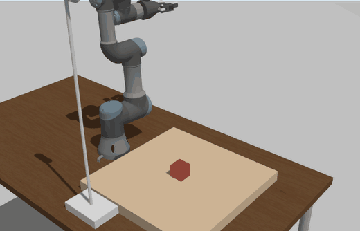 |

Status: works on the OnRobot RG2 (7 of 8 trials in a row at 1-19 mm) and, less reliably, on the Robotiq 2F-85. The RG6 and 2F-140 settings exist but are not verified yet. Each run ends by moving the arm to the `view_clear` pose, so the next run's point cloud does not contain the arm.

---

## Launch Instructions

### Full MTC Pick-and-Place Demo

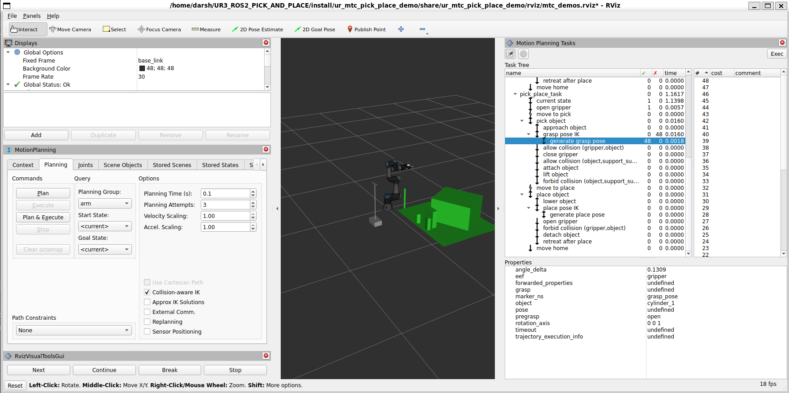

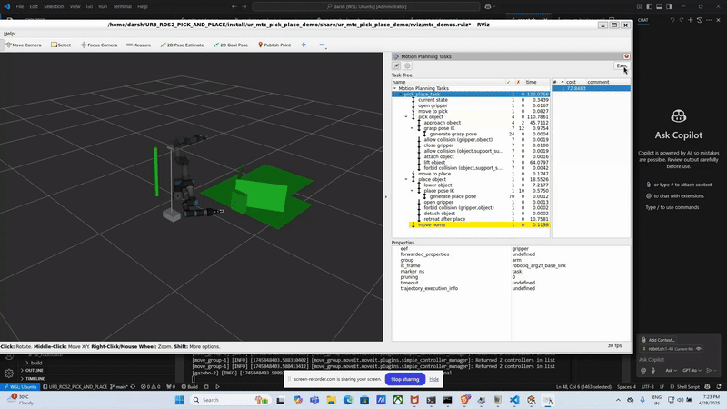

```bash
source install/setup.bash
bash ur_mtc_pick_place_demo/scripts/robot.sh              # GUI
USE_GAZEBO_GUI=false bash ur_mtc_pick_place_demo/scripts/robot.sh   # headless
```

That script just runs three launches in order (sim+MoveIt → planning scene server → pick/place task). Success looks like `Task executed successfully`. Occasional execute `-3` is RRTConnect random-seed variance, not a bug — rerun, or use the [MTC retry wrapper](#mtc-retry-wrapper) for automatic retry.

`get_planning_scene_server` turns the head depth cloud into MoveIt collision objects: crops to the workspace, RANSAC-fits the support plane and object, and serves them via `/get_planning_scene_ur`. Falls back to a known table+cylinder if perception fails or `force_fallback_scene:=true`.

### Full Simulation in Gazebo

```bash
ros2 launch ur_gazebo ur.gazebo.launch.py                       # default, Robotiq 2F-85
ros2 launch ur_gazebo ur.gazebo.launch.py gripper:=robotiq_2f_140
ros2 launch ur_gazebo ur.gazebo.launch.py gripper:=onrobot_rg2   # or onrobot_rg6
ros2 launch ur_gazebo ur.gazebo.launch.py wrist_camera:=true     # eye-in-hand instead of head cam
```

| World | Table | Objects |
|---|---|---|
| `empty.world` | no | none |
| `empty_red_cylinder.world` | no | red cylinder at `(0.36, 0, 0.06)` |
| `pick_and_place_demo.world` | yes | red cylinder + YCB props |

Launch args: `use_rviz`, `use_move_group`, `use_gazebo_gui` (all default `true`), `gripper` (default `robotiq_2f_85`), `world_file`, `table_height`, `rviz_config` (default `moveit_config/rviz/moveit.rviz` — see [Visualization & Logging](#visualization--logging) for a leaner alternative).

### Interactive MoveIt Planning in RViz

Starts move_group + RViz with `ompl` (default) and `pilz_industrial_motion_planner` pipelines.

1. **Planning Group** → `arm`
2. **Context** → Planning Library → `OMPL`, Planner → `RRTConnectkConfigDefault`
3. Drag the interactive marker to a goal, click **Plan & Execute**

Cartesian (straight-line) moves: RViz **Cartesian Path** tab, or Pilz `LIN`/`PTP`/`CIRC` planners. Configs: `moveit_config/config/ompl_planning.yaml`, `pilz_cartesian_limits.yaml`.

To attach RViz/MoveIt to a sim already running headless, use `moveit_config move_group.launch.py` with `use_move_group`/`use_rviz`/`use_sim_time` flags instead.

Wait ~10-15s after launch, then confirm:

```bash
ros2 control list_controllers   # arm_controller, gripper_controller, joint_state_broadcaster — all active
```

---

## Supported Grippers

| Gripper | Arg | Actuated joint | Range (open→closed) |
|---|---|---|---|
| Robotiq 2F-85 | `robotiq_2f_85` | `finger_joint` | 0.0 → 0.8 |
| Robotiq 2F-140 | `robotiq_2f_140` | `finger_joint` | 0.0 → 0.8 |
| OnRobot RG2 | `onrobot_rg2` | `gripper_joint` | 0.0 → 1.3 |
| OnRobot RG6 | `onrobot_rg6` | `gripper_joint` | 0.0 → 1.3 |

**Default gripper: `onrobot_rg2`** (best benchmark result, see below). Every single-arm launch file reads `UR_GRIPPER`, so `export UR_GRIPPER=robotiq_2f_85` switches the whole stack (Gazebo, MoveIt, MTC, `MotionExecutor`) at once; the `gripper:=` launch argument still overrides it. The dual-arm launches stay on the Robotiq grippers.

All use `position_controllers/GripperActionController`. Mimic joints are state-only — Gazebo Harmonic enforces `<mimic>` constraints at the physics level.

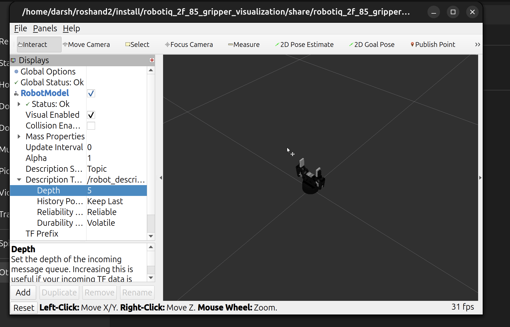

```bash
ros2 action send_goal /gripper_controller/gripper_cmd control_msgs/action/GripperCommand \
  "{command: {position: 0.5, max_effort: 50.0}}"
```

Useful debug commands: `ros2 topic echo /joint_states`, `ros2 topic hz /camera_head/depth/color/points`, `ros2 run tf2_ros tf2_echo base_link tool0`.

---

## Move the Arm from CLI

```bash
ros2 action send_goal /arm_controller/follow_joint_trajectory control_msgs/action/FollowJointTrajectory \
'{"trajectory": {"joint_names": ["shoulder_pan_joint","shoulder_lift_joint","elbow_joint","wrist_1_joint","wrist_2_joint","wrist_3_joint"],
  "points": [{"positions": [0.0, -1.57, 1.57, 0.0, 1.57, 0.0], "time_from_start": {"sec": 2, "nanosec": 0}}]}}'
```

Automation script: `python3 ur_system_tests/scripts/arm_gripper_loop_controller.py`. GUI: `python3 ur_system_tests/scripts/gui.py`.

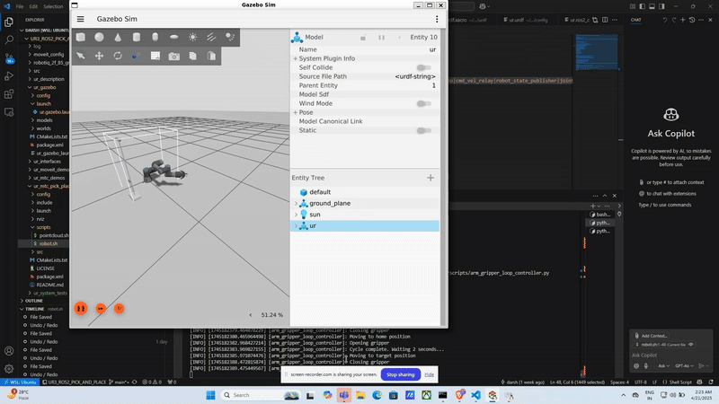

---

## Full Autonomous Pipeline

`full_demo.launch.py` brings up Gazebo, MoveIt, perception, grasp detection, and a selectable brain (mutually exclusive):

```bash
ros2 launch ur_gazebo full_demo.launch.py brain:=llm      # Ollama, via /llm_planner/command
ros2 launch ur_gazebo full_demo.launch.py brain:=rl model_path:=ur_rl_training/models/checkpoints/<run>/best_model.zip
ros2 launch ur_gazebo full_demo.launch.py brain:=openvla task:="pick the red block and place it in the bin"
ros2 launch ur_gazebo full_demo.launch.py brain:=none     # perception + grasp only
```

Startup sequence: Gazebo+MoveIt → perception (60s) → grasp (62s) → brain (65s).

```
Camera/Depth  → ur_perception → /detected_objects        → LLM planner / RL policy
PointCloud2   → ur_grasp      → /ur_grasp/grasp_pose      → RL policy (overrides perception)
Camera        → OpenVLA       → /arm_controller/joint_trajectory
```

---

## Grasp Detection (ur_grasp)

Estimates grasp poses from the D435 point cloud — `simple_grasping` (PCL RANSAC, primary) or a built-in HSV-centroid fallback.

```bash
ros2 launch ur_grasp grasp_detection.launch.py colour:=red
python3 testing/test_grasp.py --colour red --execute
```

For eye-in-hand: launch sim with `wrist_camera:=true`, then point `grasp_detection.launch.py` at `camera_topic:=/camera_wrist/depth/color/points`. Publishes `/ur_grasp/grasp_pose` and `/ur_grasp/grasp_marker`.

---

## UR3 Reinforcement Learning (SAC)

Trains SAC in MuJoCo, deploys to Gazebo — reach → grasp → lift → place curriculum (auto-advances at eval reward ≥ 400), with domain randomization on mass/friction/size/noise.

```bash
cd ur_rl_training
python3 scripts/train.py --timesteps 3000000
python3 scripts/train.py --resume models/checkpoints/<run>/best_model   # resume from checkpoint
```

Deploy to Gazebo:

```bash
ros2 launch ur_gazebo ur.gazebo.launch.py world_file:=rl_policy_demo.world
ros2 launch ur_rl_training rl_policy.launch.py model_path:=ur_rl_training/models/checkpoints/<run>/best_model.zip
```

Key params: `action_scale` (0.1), `step_dt` (0.01), `control_rate_hz` (100), `phase` (0-3); object position auto-overridden by perception/grasp topics when running.

Headless eval: `python3 ur_rl_training/scripts/eval_headless.py --model <path> --episodes 20`.

Compare training runs (reads all `ur_rl_training/logs/*/evaluations.npz`, no launch needed):

```bash
python3 testing/plot_rl_run_comparison.py
# -> testing/rl_learning_curves.png, testing/rl_best_reward_bar.png
```

---

## Force Control / Compliant Grasping (`ur_force_control`)

**Gripper contact** — monitors `finger_joint` effort to stop before crushing:

```bash
ros2 launch ur_force_control ft_monitor.launch.py
```
`/ft/finger_effort` (effort), `/ft/contact_detected` (bool), service `/ft/compliant_close`. Also via `MotionExecutor.compliant_close_gripper()` / `.compliant_pick()`.

**Arm-level wrench estimation** (no F/T sensor — inferred from joint effort via `F ≈ pinv_damped(Jᵀ)·τ_ext`, gravity via Pinocchio):

```bash
ros2 launch ur_force_control wrench_estimator.launch.py
ros2 topic echo /ft/estimated_wrench
ros2 service call /ft/zero_wrench std_srvs/srv/Trigger {}
```
Params: `force_threshold_n` (15.0), `damping_lambda` (0.05). Note: `/joint_states` effort readback doesn't reliably track commanded torque, so absolute wrench values aren't trustworthy yet — relative/contact detection is fine.

**Joint impedance control** (torque mode, `τ = K(q_des−q) − D·q̇ + g(q)`):

```bash
ros2 launch ur_force_control joint_impedance.launch.py
ros2 control switch_controllers --deactivate arm_controller --activate forward_command_controller_effort
ros2 topic pub --once /joint_impedance_controller/target_positions std_msgs/msg/Float64MultiArray "{data: [0.0, -1.57, 1.57, 0.0, 1.57, 0.0]}"
ros2 control switch_controllers --deactivate forward_command_controller_effort --activate arm_controller   # hand back
```
Use `arm_controller` for MoveIt; switch to `forward_command_controller_effort` only for compliant hold/contact. Service: `/joint_impedance_controller/hold_current_pose`.

---

## Behavior Tree Task Planner (`ur_bt_planner`)

Hierarchical [py_trees](https://py-trees.readthedocs.io/) pick-and-place with IK-failure retry via a Selector fallback:

```bash
ros2 launch ur_bt_planner bt_planner.launch.py pick_x:=0.35 pick_y:=0.0 pick_z:=0.05 place_x:=0.15 place_y:=0.30 place_z:=0.08
ros2 service call /bt/run_pick_place std_srvs/srv/Trigger {}
```

### MTC Retry Wrapper

Wraps the [MTC demo](#full-mtc-pick-and-place-demo) with automatic retry (`py_trees.decorators.Retry`) since occasional `-3` execute failures resolve on a fresh attempt:

```bash
ros2 launch ur_gazebo ur.gazebo.launch.py world_file:=pick_and_place_demo.world gripper:=robotiq_2f_85 \
  use_rviz:=false use_move_group:=true use_gazebo_gui:=true
ros2 launch ur_bt_planner mtc_retry.launch.py
ros2 service call /mtc_bt/run std_srvs/srv/Trigger {}
ros2 topic echo /mtc_bt/status
```
`max_attempts` (default 5) is a launch arg.

---

## Conveyor Belt Simulation (`ur_conveyor`)

Spawns random-color boxes at the belt entry, moves them to the pick zone, publishes `/conveyor/object_ready`.

```bash
ros2 launch ur_conveyor conveyor.launch.py spawn_interval_s:=6.0 belt_speed:=0.06
ros2 service call /conveyor/start std_srvs/srv/Trigger {}
```

Topics/services: `/conveyor/object_ready`, `/conveyor/picked`, `/conveyor/start`, `/conveyor/stop`.

---

## Dual-Arm Support

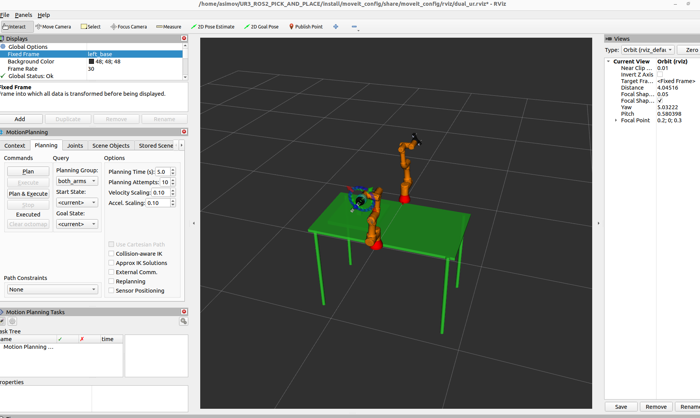

Two independent UR3+gripper arms (`left_`/`right_` prefixed) on one shared world frame, one Gazebo model, one `controller_manager`.

```bash
ros2 launch ur_gazebo dual_ur.gazebo.launch.py            # GUI
ros2 launch ur_gazebo dual_ur.gazebo.launch.py use_gazebo_gui:=false gripper:=robotiq_2f_85
```

Args: `gripper` (all 4 grippers — robotiq and onrobot — now have MoveIt groups, not just raw joint control), `table_height`, `left_y`/`right_y` (base offsets, 0.45m/-0.45m default — arms face each other 0.9m apart), `world_file`, `use_move_group`, `use_rviz`, `use_dual_cameras` (opt-in per-arm D435, default false).

MoveIt planning groups exist for each arm independently (`left_arm`/`right_arm`/`left_gripper`/`right_gripper`, plus `both_arms` for future bimanual planning) — `move_group` and RViz launch by default, same workflow as the single-arm demo. Live-verified: both arms' controllers activate and `move_group` comes up clean (see `project_dual_arm_bullet_featherstone_crash` memory for a physics-engine quirk that was hit and fixed along the way).

**Independent per-arm pipelines** (namespaced `left`/`right`, fallback planning scene — no live perception dependency yet):

```bash
ros2 launch ur_gazebo dual_mtc_pick_place.launch.py     # two mtc_node instances
ros2 launch ur_bt_planner dual_mtc_retry.launch.py      # + BT auto-retry per arm
ros2 launch ur_sorting_demo dual_sorting_demo.launch.py # workspace-split sorting
```

**Whole-body coordination** (`ur_dual_coordination`): both hands holding one object, all 12 joints solved together in priority order: (1) keep the hands' relative pose frozen and the arms apart, (2) move the object to its target, (3) stay near a comfortable posture; joint limits are enforced by freezing the joints that would leave their range. Because the relative pose is the top priority, the object is neither squeezed nor pulled, and the motion is shared between the arms.

```bash
ros2 launch ur_dual_coordination dual_coordination.launch.py               # with the dual-arm sim running
ros2 service call /dual/grasp std_srvs/srv/Trigger {}                      # freeze the hands' relative pose
ros2 topic pub --once /dual/object_target geometry_msgs/msg/PoseStamped \
  "{header: {frame_id: world}, pose: {position: {x: 0.2, y: 0.0, z: 0.31}, orientation: {w: 1.0}}}"
ros2 service call /dual/release std_srvs/srv/Trigger {}
```

Verified offline against the real dual-arm URDF (`testing/test_dual_coordination.py`): the object reaches its target within 3 mm, the hands stay within 1 mm of each other, the arms keep at least 10 cm apart, and joint limits are never exceeded. On the simulated controllers (`testing/dual_sim_test.py`): moving the object 6 cm up, forward and sideways it reaches each target within 0.6 mm and the hands stay within about 2 mm of each other; all four moves (up, forward, sideways and back to the start) land within 0.5 mm of their targets and the hands stay within about 5 mm of each other.

Namespacing (services, node names, `/left`/`right` topics) is live-verified with no collisions. Note: the object/place/bin/handover poses these use are TODO placeholders extrapolated from the single-arm demo's numbers, not yet confirmed reachable — tune them against real workspace geometry before treating a run as a working demo rather than a wired-up pipeline.

---

## Visualization & Logging

**RViz.** The default config (`moveit_config/rviz/moveit.rviz`, also used by `dual_ur.gazebo.launch.py` via `dual_ur.rviz`) now starts framed on the workspace instead of zoomed out to the whole world, has the MTC **Motion Planning Tasks** panel pre-expanded with computation times shown, and carries a **Detection Image** display (`/detection_image`, off by default — enable it in the Displays panel when `ur_perception`'s object detector is running).

For a monitoring-only view (no planning controls, no MTC debug panel), pass an alternate config:

```bash
ros2 launch ur_gazebo ur.gazebo.launch.py \
  rviz_config:=$(ros2 pkg prefix moveit_config)/share/moveit_config/rviz/operator_view.rviz
```

**Web dashboard (`ur_web_dashboard`).** Browser UI with a live camera feed, joint-state bars, detected-object list, LLM command box (with voice input), and a filterable `/rosout` log panel — searchable by node/message, filterable by severity, light/dark toggle (persisted).

```bash
ros2 launch ur_web_dashboard dashboard.launch.py   # rosbridge (9090) + web_video_server (8080)
# then open ur_web_dashboard/web/index.html in a browser
```

**Native log/plot viewers.** `rqt_console` and PlotJuggler, wired up as a convenience launch:

```bash
ros2 launch ur_web_dashboard view_logs.launch.py                    # both
ros2 launch ur_web_dashboard view_logs.launch.py plotjuggler:=false # rqt_console only
```

---

## Gripper Benchmark (`testing/`)

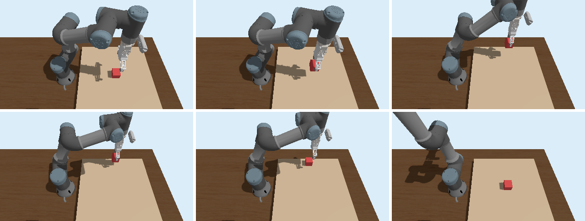

*OnRobot RG2 picking a 5 cm cube (left to right, top to bottom: arm at home, approach, grasp, lift, carry, placed).*

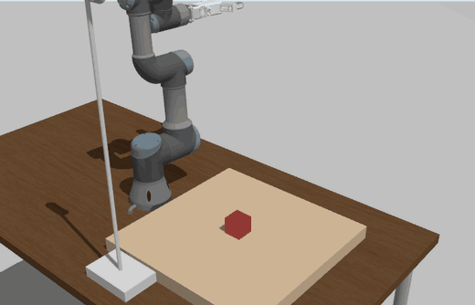

<details>
<summary>More animated pick and places (other grippers and shapes)</summary>

| | |
|---|---|
| Robotiq 2F-85, 5 cm cylinder | Robotiq 2F-140, 5 cm cube |
| 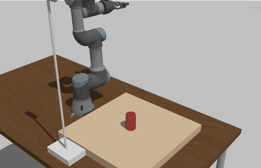 | 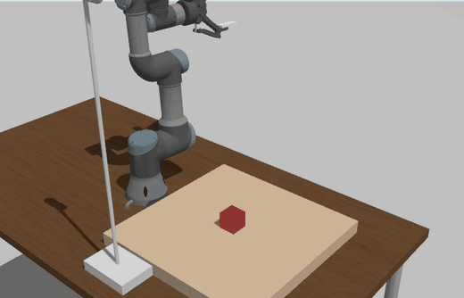 |
| OnRobot RG6, 5 cm cube | OnRobot RG2, tall box |
|  |  |
| OnRobot RG2, 5 cm cylinder | |
| 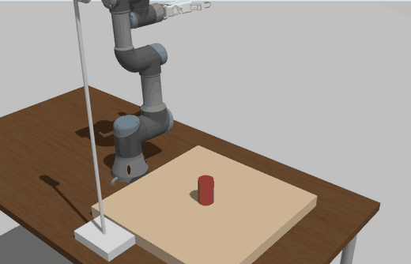 | |

</details>

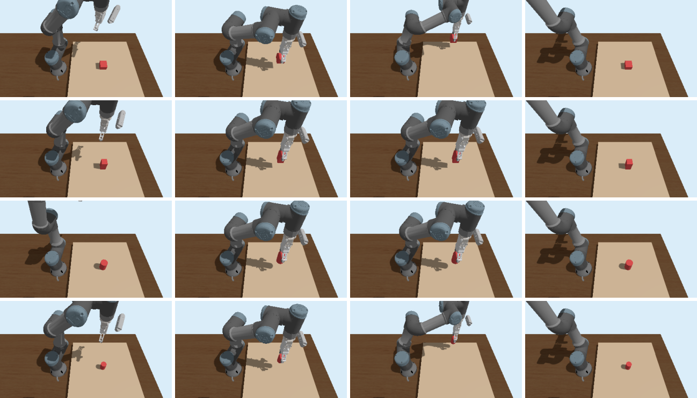

*Four shapes, OnRobot RG2. Rows, top to bottom: 5 cm cube, tall box, 5 cm cylinder, 4 cm cylinder. Columns: approach, grasp, carry, placed.*

<details>
<summary>Other grippers (each picking the 5 cm cube)</summary>

Robotiq 2F-85:

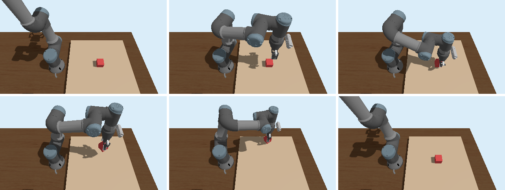

Robotiq 2F-140:

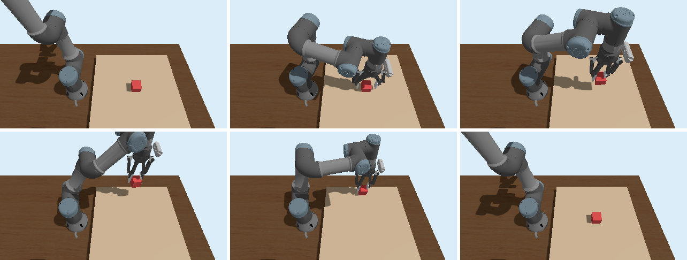

OnRobot RG6:

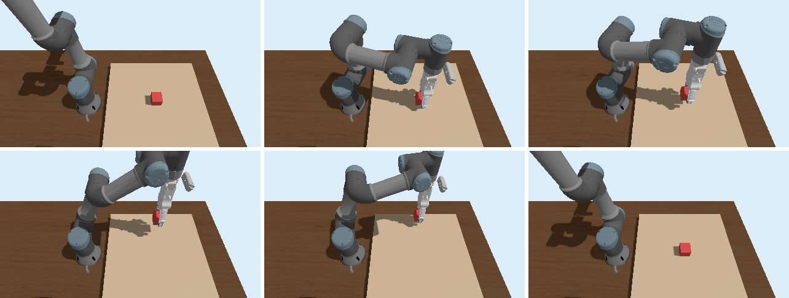

</details>

```bash
python3 testing/benchmark_grippers.py --trials 5 --domain 91 --output results.csv   # all grippers x objects
python3 testing/benchmark_grippers.py --grippers onrobot_rg2 --objects cube_5cm --record-dir frames/   # + PASS/FAIL image strips
python3 testing/benchmark_grippers.py --summarise-csv results.csv                   # print the table again
```

| Script | Purpose |
|---|---|
| `benchmark_grippers.py` | The benchmark (per-gripper profiles live in `MotionExecutor.GRIPPER_PROFILES`) |
| `measure_tcp.py` | Where the finger pads really are vs where the code aimed (fingertip offset per gripper) |
| `sweep_tcp.py` | Try several fingertip offsets in the sim and report passes per offset |
| `collect_grasp_data.py`, `train_grasp_model.py`, `grasp_predictor.py` | Collect labelled grasps, train a "held?" / grasp-quality model, use it |
| `capture_frames.py` | Save camera frames from the headless sim as PNGs |
| `benchmark_mtc.py` | The same benchmark through MoveIt Task Constructor (`mtc_retry.launch.py`) |
| `gripper_selftest.py` | Check a gripper mechanism in the sim: joints follow commands, fingers symmetric, no jams |
| `test_grasp_logic.py` | Offline unit tests (no sim): `PYTEST_DISABLE_PLUGIN_AUTOLOAD=1 python3 -m pytest testing/test_grasp_logic.py` |

Latest full run (4 objects x 5 trials each, pick & place): RG2 80%, 2F-85 60%, 2F-140 35%, RG6 30%.

---

## Future Scope / Work in Progress

- Real robot deployment (swap Gazebo hardware interface for the live UR3 driver)
- Fine-tune OpenVLA on collected demonstrations for sim-to-real
- 6-DoF object pose estimation from depth for grasp orientation
- Dual-arm MTC task graph for [coordinated bimanual pick](#dual-arm-support)
- Multi-object sorting: BT planner + conveyor + perception together
- **Vision (`ur_perception`)**: color/YOLO detection works; multi-view reconstruction (`reconstruct.launch.py`) is inspection-only, not yet consumed by the pick pipeline
- **LLM planner (`ur_llm_planner`)**: relative moves (`move the gripper up by 10 centimeters`) and named poses work; pick-by-description doesn't yet — the color detector reports zero objects for this scene

Contributions welcome, especially around sim stability, transfer learning, and perception-to-action integration.
