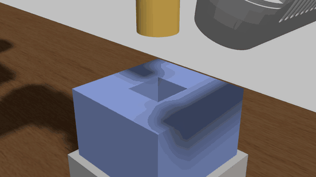

# UR3 peg-in-hole with Cartesian impedance control

Peg-in-hole in headless Gazebo and in MuJoCo, with a Cartesian impedance controller, force-triggered spiral search, camera frames, and contact-force plots (commanded and, in Gazebo, measured by a force/torque sensor).



## Gazebo (ros2_control, effort mode)

```bash
colcon build --packages-select moveit_config ur_description ur_gazebo ur_force_control
python3 ur_force_control/scripts/record_peg_in_hole.py --out assets/gifs/peg_in_hole_ur3.gif --offset-x 0.0004
python3 ur_force_control/scripts/record_peg_in_hole.py --out assets/gifs/peg_in_hole_ur3_spiral.gif --offset-x 0.004 --search
```

The script starts the sim (server only, `--headless-rendering`), moves the UR3 above the hole with `arm_controller`, switches to
`forward_command_controller_effort`, runs `cartesian_impedance_controller` and `peg_in_hole_task.py`, films the `peg_close` camera, and
writes `<out>.gif`, `<out>.csv` and `<out>_forces.png`. Extra options: `--domain N --gz-partition NAME` (run next to another sim without crosstalk), `--t-end S` (task time limit), `--stiffness K`.

| Piece | File |
|---|---|
| Controller `tau = J^T [K (x_des - x) - D v] + g(q)` (Pinocchio) | `src/cartesian_impedance_controller.cpp` |
| Descent, jam detection, spiral search, CSV log | `ur_force_control/peg_in_hole_task.py` |
| World: square hole, 0.5 mm clearance per side, 30 mm deep, two cameras | `ur_gazebo/worlds/peg_in_hole.world` |
| Rigid peg tool (`gripper:=peg`) with a force/torque sensor `peg_ft` on `peg_joint`, 500 Hz controller config | `ur_description/urdf/ur_macro.xacro`, `moveit_config/config/ros2_controllers_peg.yaml` |
| `ForceTorque` system for the sensor | `ur_gazebo/worlds/peg_in_hole.world` |

Controller topics: `~/target_pose`, `~/stiffness` (6 values, change impedance on the fly), `~/tip_pose`, service `~/hold_current_pose`.

## MuJoCo

`ur_force_control/peg_in_hole_env.py` (UR3) and `scripts/peg_in_hole_impedance.py`, `scripts/peg_in_hole_spiral_search.py` (force plots for several stiffnesses and offsets).

## Things to know

- **Switch controllers once per sim session.** After `arm_controller` -> `forward_command_controller_effort` the Gazebo joints stay in force mode, so switching back does not move the arm. Restart the sim to retest.
- **The controller loop must be fast.** The UR3 wrists have about 1e-3 kg m^2 of joint inertia and no armature. At the default 100 Hz the controller is unstable; the `peg` config runs at 500 Hz and the damping defaults are low on purpose.
- **Poses are in the URDF root frame**, which includes the table height: the hole top face is at z = 1.135.
- **Measured force.** The `peg_ft` sensor (gz `force_torque`, 500 Hz, on `peg_joint`) is bridged to `/peg_ft` (`geometry_msgs/WrenchStamped`) by the recorder. `peg_in_hole_task.py` averages the free-space reading during the first part of the settle phase (the peg weight, about 1 N) and subtracts it, then logs `f_meas_lateral` / `f_meas_axial` next to the commanded impedance force `K (x_des - x)` (`f_lateral` / `f_axial`). The plots show both. In the 4 mm jam (`peg_in_hole_ur3_jam_measured`) they agree: 23.4 N measured against 22.4 N commanded at the plateau. Only the peg joint is measured, so a collision of another arm link is invisible to it.
- **Gazebo contact is more forgiving than the model, and I could not tighten it.** The hole has 0.5 mm clearance per side, but a peg offset 1.5 mm often still goes in. What I tried:
  - Bullet-featherstone ignored `kp` / `kd` / `minDepth` on the peg (no change; I could not find documentation that it reads them), so they are not in the repo.
  - A zero-clearance hole (inner faces at the peg radius) still let a +1.5 mm offset in.
  - K = 2500 N/m instead of 800 made rim contact violent (931 N commanded, 2419 N measured on a +1.5 mm run), so it is not usable as is.
  - A hole-centre correction of (+1 mm, +1 mm) was tried because +1.5 mm inserted and -1.5 mm jammed in the same session, but a second session showed the opposite, so it was reverted. The outcome at 1.5 mm depends on direction and on the run.
  - Untested hypothesis: at K = 800 N/m the impedance controller is compliant enough (1 N of rim reaction moves the peg 1.25 mm) to slide the peg in by itself.
- **Occasional runs stall with no peg contact.** In about 4 of roughly 15 runs (mostly negative offsets) the tip stopped 6 to 25 mm above the hole with 299 N commanded and about 0 N measured on the peg, so something other than the peg was blocking the arm. Re-run those.
- Treat the Gazebo numbers as qualitative; use the MuJoCo scripts for clearance and force studies.

Results from the three recorded runs (K = 800 N/m, 10 mm/s):

| Run | Offset | Result | Peak axial / lateral |
|---|---|---|---|
| plain descent | 0.4 mm | inserts | 0.7 N / 0.3 N |
| plain descent | 4 mm | jams on the rim | 21.6 N / 3.2 N |
| spiral search | 4 mm | inserts after about 5 s of search | 3.6 N / 12.9 N |
| plain descent, measured force (`peg_in_hole_ur3_jam_measured`) | 4 mm | sticks on the rim for about 12 s (23.4 N measured), then creeps in | 23.4 N plateau, 36 N peak axial / 15.8 N peak lateral (at the slip-in), measured |

The jam and spiral rows are commanded force only (recorded before the sensor existed); `peg_in_hole_ur3` and `peg_in_hole_ur3_jam_measured` include the measured columns.
